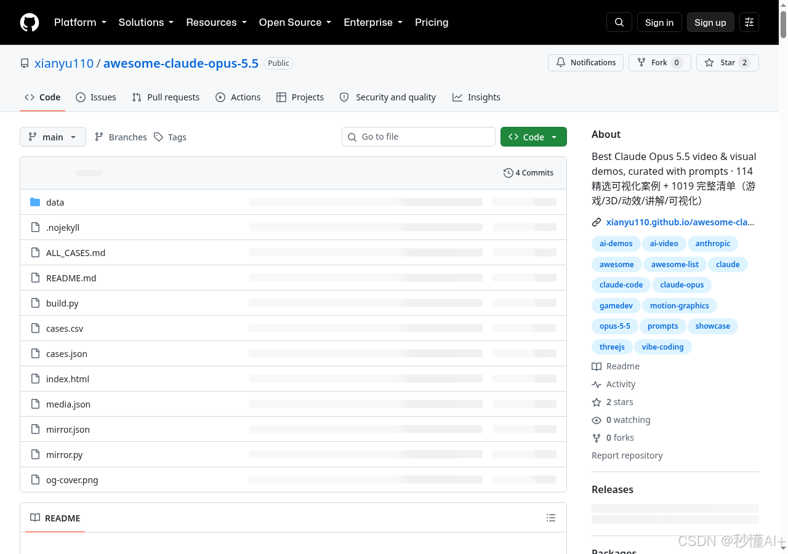
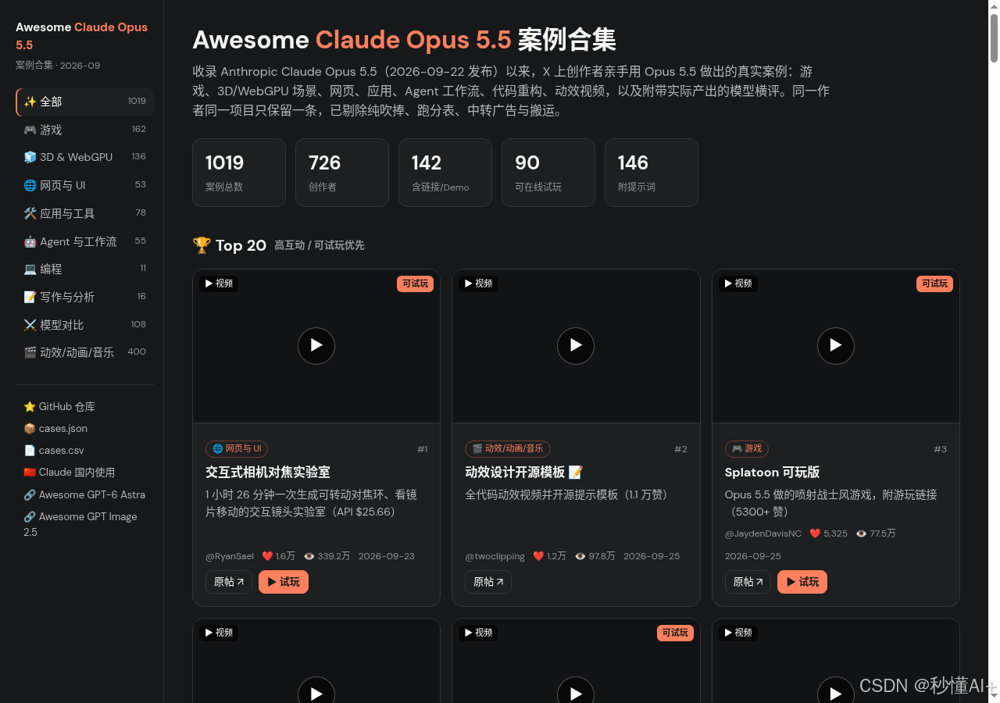

> 在线阅读（GitHub Pages）：https://maynor996.github.io/opus55-viz-gallery/

# Claude Opus 5.5 最强可视化案例合集：114 精选 + 1000+ 完整清单（含提示词）

最近刷 X，Claude Opus 5.5 做出的游戏、3D、动效、讲解动画一波接一波——但帖子散落各处，想复现还得自己翻提示词。

[xianyu110/awesome-claude-opus-5.5](<https://github.com/xianyu110/awesome-claude-opus-5.5>) 把这件事做成了：

  * **114 个精选案例** （游戏 / 动效 / Three.js / Blender / 讲解 / 可视化 / Agent 工作流等）
  * **1019 条完整清单** （原始抓取一条不少）
  * 能找到的 **提示词一并收录**
  * 还有 **在线画廊** ：可搜索、按分类筛选、直接播视频

🌐 在线画廊：https://xianyu110.github.io/awesome-claude-opus-5.5/  
📦 GitHub：https://github.com/xianyu110/awesome-claude-opus-5.5

### 里面有什么硬货

按互动数据（点赞+收藏+转发）筛过，同作者最多 2 条，偏视频/动图。举几个顶流：

类型| 案例| 互动量级  
---|---|---  
交互可视化| 交互式相机对焦实验室| ❤ 1.6万+  
动效| 动效设计开源模板（附完整提示词）| ❤ 1.2万+  
同题对比| 五模型 3D 打印桥梁| ❤ 8.4k  
游戏| Splatoon 可玩版 / 电车难题游戏 / 塞尔达风| ❤ 5k 级  
Agent| Rust→汇编 17× 加速、强制开工 ToDo、12 台电脑协同发布片| ❤ 4k–5k  
  
分类覆盖：游戏、动效宣传片、Three.js/WebGPU、Blender/UE/Godot、讲解动画、交互模拟、网页 UI、音乐 MV、Apps & Agent、模型同题对比。

### 怎么用

  1. 打开仓库或在线画廊，按兴趣点进条目（原帖 / Demo / 提示词）。
  2. 复制提示词到 Claude Opus 5.5（Claude Code / App / 任意接入）。
  3. 动效/讲解类建议要求：单 HTML + 时间轴渲染 + ffmpeg 导出；游戏/3D 多轮迭代很正常。

仓库里还单独整理了「附提示词」章节，例如动效开源模板、Transformer 讲解、《大气环流》地理动画等，可直接抄作业。

### 一句话

想看 Opus 5.5 **到底能做出什么** ，别再大海捞针刷时间线了——先收藏这个清单，按分类刷完 114 精选，再按需翻完整 1000+。

GitHub：https://github.com/xianyu110/awesome-claude-opus-5.5  
画廊：https://xianyu110.github.io/awesome-claude-opus-5.5/

（转载请注明来源仓库；案例版权归原作者，条目均链回原帖。）